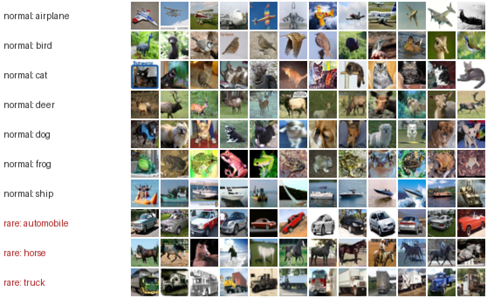
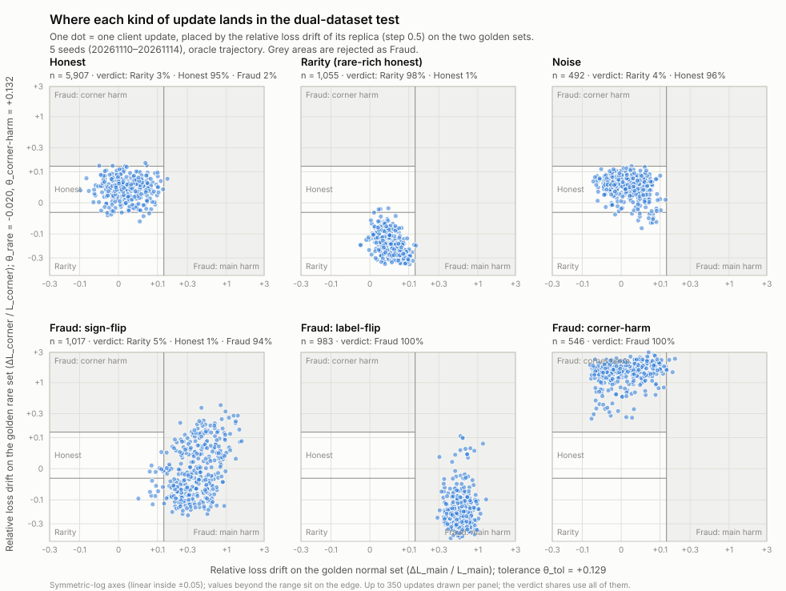
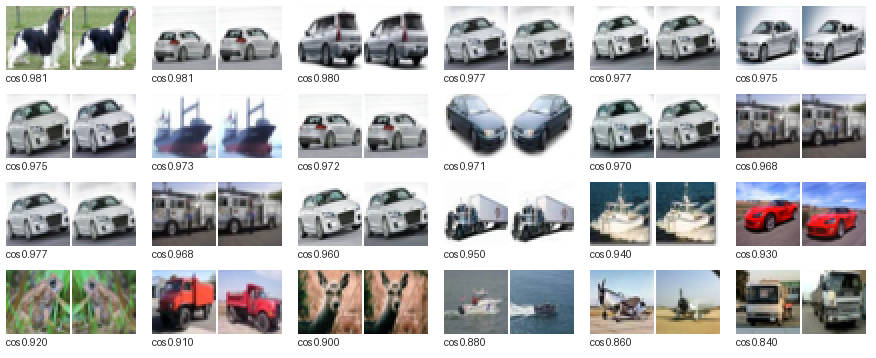

# CIFAR-10 Dual-Dataset Rarity Benchmark

This benchmark re-runs the thesis's central test on a harder public dataset and
against a wider set of baselines, including FedVal:

> An uploaded client update is applied to a replica of the global model. Its
> loss drift is measured on two server-held golden sets, a normal set `D_main`
> and a rare set `D_corner`. The pair (ΔL_main, ΔL_corner) decides whether the
> update is Fraud, Rarity, Honest or Noise.

The question is the thesis's research question: can the server discover the
rare-beneficial updates among suspicious ones without keeping harmful ones?

Code: `backend/dual_dataset_benchmark/` (torch and numpy only).
Parameters: `configs/cifar10_dual_dataset.yaml`.
Frozen operating point: `configs/cifar10_dual_dataset_policy_r50head.json`.

## What changed against the thesis real-gradient benchmark

| Aspect | Thesis real-gradient benchmark | This benchmark |
|---|---|---|
| Data | MNIST, FashionMNIST, FEMNIST | CIFAR-10 |
| Golden data | half of the test split; `D_main` contains `D_corner` | a quarter of CIFAR-10, annotated; `D_main` and `D_corner` are disjoint |
| How rare the rare classes are | as frequent as every other class (MNIST, FashionMNIST shards) | 10.5% of the client images, concentrated in 15% of the clients |
| Client update | one gradient step on a fixed 784-64-10 MLP | two local epochs of SGD; every method trains its own model for 100 rounds |
| Fraud | built from the server's own audit gradients | built from the client's own data or update |
| L2 rule | `l2_dual_audit/classifier.py` | thesis Table 4.2 as written (the two differ, see below) |
| Thresholds | fixed absolute values | relative drift; percentiles of honest development updates, frozen before the confirmatory seeds |
| What is measured | fraud survival, rarity retention | also rarity recognition and precision, the update-level confusion, and every method's score on one shared update stream |
| Baselines | Multi-Krum, FLTrust, Zeno, Zeno++ | plus FedAvg, GeoMed, FedVal and a ground-truth oracle |

`classifier.py` and thesis Table 4.2 are not the same rule. The code rejects a
corner-harmful update only when its main drift is non-positive and has no
utility floor; the thesis rejects it whenever the main drift is inside the
tolerance and separates Noise from Honest with θ_util. This benchmark
implements the thesis table (`detectors.dual_verdict`).

## Golden dataset

`scripts/annotate_cifar10_golden.py` pools the 60,000 CIFAR-10 images and
splits every class with a fixed seed. One quarter is annotated; three quarters
are left unannotated and used for testing.

| Surface | Images | Use |
|---|---:|---|
| golden, normal (`D_main`) | 10,500 | airplane, bird, cat, deer, dog, frog, ship: 1,500 each |
| golden, rare (`D_corner`) | 4,500 | automobile, horse, truck: 1,500 each |
| test, client pool | 40,000 | client shards that produce the updates under test |
| test, evaluation | 5,000 | accuracy read-out, 500 per class |



Twelve golden images of every class; the three rare classes are at the bottom.

The rare classes are the repository's `DEFAULT_CORNER_LABELS = (1, 7, 9)`.
Every round the server draws 100 golden images per class (700 normal, 300
rare); over a run the whole golden quarter is used. The validation-based
baselines (Zeno, Zeno++, FLTrust, FedVal) receive the same draw, pooled.

## Federation and update types

120 clients, 224 images each, 20 sampled per round. Roles are fixed per seed
and follow the thesis mix (Table A.1).

| Type | Clients | Data | Upload | Truth |
|---|---:|---|---|---|
| Honest | 72 | 2% rare images, Dirichlet(0.5) over the normal classes | its update | Honest |
| Rarity | 12 | 60% rare images | its update | Rarity |
| Noise | 6 | as honest | update plus Gaussian noise of twice its norm | Noise |
| Sign-flip | 12 | as honest | −3 × update | Fraud, main-hostile |
| Label-flip | 12 | as honest, every label y → 9 − y | its update | Fraud, main-hostile |
| Corner-harm | 6 | as rarity, rare labels flipped to a normal class | its update | Fraud, main-safe and corner-hostile |

Rarity truth is the thesis rule: an honest shard with at least 30% rare-class
images. A corner-harm client holds the same images as a rarity client, so the
two are the ambiguity the thesis is about. The `no_attack` scenario uses the
same shards with every client honest (18 rarity clients).

## Models

| Back-end | Role | Model |
|---|---|---|
| `r50head` | primary | a frozen ImageNet ResNet-50 embeds every image (2,048-d); the federation trains an MLP head 2048 → 128 → 10 |
| `cnn` | development-seed diagnostic | a three-layer CNN with GroupNorm trained from scratch |

The CNN is not used for confirmation: in this long-tailed federation it reaches
46% on the normal classes and 3% on the rare classes after 120 rounds even
under the oracle, so preserving rarity cannot show in its accuracy. The
embedding model is a fixed public encoder; only the head is exchanged.

## The dual-dataset test

- Replica: `W' = W + η·u_i`, η = 0.5.
- Drift: relative, `ΔL / L(W)`, on each golden set. On the development seeds
  the rare-set loss falls about fourfold during training, while the 99th
  percentile of the relative drift of honest updates moves by at most 15%
  between the early, middle and late rounds.
- Verdict, in order (thesis Table 4.2): main drift above θ_tol → Fraud; corner
  drift above θ_corner-harm → Fraud; corner drift at or below θ_rare → Rarity;
  otherwise Noise if the update was deviation-nominated and improved neither
  set, else Honest.
- L1 routing (thesis Table 4.1): geometric-median cosine deviation, norm MAD,
  sign disagreement, and a 0.25 recheck. `cd_exhaustive` audits everything.
- Embedding-space variant (`cd_embedding`): the same rule, with the loss
  replaced by a class-prototype read-out of the replica's own 128-d embedding
  on the golden draw. It ignores the output layer.

## Calibration

`scripts/calibrate_cifar10_dual_dataset.py` reads the oracle trajectories of
development seeds 20261101 and 20261102 (4,000 updates, 2,377 honest).

| Parameter | Rule | Value |
|---|---|---:|
| Replica step η | best worst-case AUROC over {1, 0.5, 0.25} | 0.5 |
| θ_tol | 99th percentile of honest drift on the normal set | +0.130 |
| θ_corner-harm | 99th percentile of honest drift on the rare set | +0.132 |
| θ_rare | 1st percentile of honest drift on the rare set | −0.020 |
| θ_util | any measurable improvement on either set | 1e-6 |
| L1 cosine / norm-MAD / sign | 95th percentile of each signal over honest updates | 0.926 / 2.055 / 0.446 |
| Recheck probability | thesis Table 4.1 | 0.25 |

No Rarity or Fraud label enters a threshold; they only choose η. Head learning
rate 0.03 was chosen on one development seed from {0.003, 0.01, 0.03, 0.1}.
Multi-Krum and Zeno are given the true expected number of attackers (5 of 20).

## Results

Five confirmatory seeds (20261110–20261114), 100 rounds, 20 updates per round,
frozen policy. Accuracy is the mean of the last ten rounds on the evaluation
set; figures are mean ± half-width of the 95% t-interval over seeds.



### Where each update type lands

Relative loss drift on the two golden sets, oracle trajectory, median [p5, p95].

| True type | n | Normal set | Rare set |
|---|---:|---:|---:|
| Honest | 5,907 | +0.016 [−0.026, +0.078] | +0.036 [−0.013, +0.098] |
| Rarity | 1,055 | +0.041 [+0.009, +0.092] | −0.177 [−0.333, −0.057] |
| Noise | 492 | +0.012 [−0.031, +0.066] | +0.046 [−0.015, +0.098] |
| Fraud: sign-flip | 1,017 | +0.395 [+0.120, +0.970] | −0.008 [−0.134, +0.169] |
| Fraud: label-flip | 983 | +0.593 [+0.373, +0.910] | −0.196 [−0.418, −0.008] |
| Fraud: corner-harm | 546 | +0.007 [−0.054, +0.099] | +1.563 [+0.572, +2.282] |

Label-flip lowers the rare-set loss as much as true rarity does, because it
pushes predictions toward the rare labels. Only the normal set exposes it.

### Rarity discovery (mixed attack)

| Audit | Review rate | Recognition | Precision | Named Rarity | of which fraud | of which honest or noise |
|---|---:|---:|---:|---:|---:|---:|
| CornerDrive (L1+L2) | 51.3 ± 1.0 | 37.5 ± 3.3 | 83.8 ± 9.1 | 472 | 11 | 67 |
| CornerDrive (exhaustive L2) | 100 | 98.0 ± 2.1 | 86.2 ± 9.2 | 1,200 | 19 | 147 |
| CornerDrive (embedding space) | 100 | 72.8 ± 22.4 | 79.0 ± 18.1 | 966 | 1 | 184 |
| Corner-only audit | 100 | 52.6 ± 8.6 | 41.4 ± 8.7 | 1,345 | 662 | 129 |
| Main-only audit | 100 | 0.0 | – | 0 | 0 | 0 |

Update-level confusion, exhaustive L2, pooled over the five seeds:

| True type | Total | Fraud | Rarity | Honest | Noise |
|---|---:|---:|---:|---:|---:|
| Honest | 5,907 | 147 | 132 | 5,181 | 447 |
| Rarity | 1,055 | 5 | 1,034 | 16 | 0 |
| Noise | 492 | 1 | 15 | 261 | 215 |
| Fraud: sign-flip | 1,017 | 991 | 19 | 3 | 4 |
| Fraud: label-flip | 983 | 983 | 0 | 0 | 0 |
| Fraud: corner-harm | 546 | 546 | 0 | 0 | 0 |

L1 routing, CornerDrive (L1+L2), pooled:

| True type | Total | Cosine | Norm-MAD | Sign | Recheck | Not audited | Routed % |
|---|---:|---:|---:|---:|---:|---:|---:|
| Honest | 5,907 | 371 | 191 | 75 | 1,333 | 3,937 | 33.4 |
| Rarity | 1,055 | 99 | 63 | 22 | 215 | 656 | 37.8 |
| Noise | 492 | 0 | 371 | 0 | 23 | 98 | 80.1 |
| Fraud: sign-flip | 1,017 | 160 | 774 | 1 | 20 | 62 | 93.9 |
| Fraud: label-flip | 983 | 51 | 873 | 0 | 18 | 41 | 95.8 |
| Fraud: corner-harm | 546 | 45 | 399 | 0 | 28 | 74 | 86.4 |

All 472 routed corner-harm updates were rejected; the 74 that survived were
never audited. This is the thesis's routing-limited survival, on real data.

### Method comparison (mixed attack)

Share is the mean aggregation weight relative to an equal share (FedAvg = 1.00).

| Method | Normal acc | Rare acc | All acc | Rarity kept | Sign-flip share | Label-flip share | Corner-harm share |
|---|---:|---:|---:|---:|---:|---:|---:|
| Oracle | 90.4 ± 0.4 | 87.5 ± 1.1 | 89.5 ± 0.2 | 100 | 0.00 | 0.00 | 0.00 |
| FedAvg | 63.8 ± 11.0 | 61.1 ± 16.0 | 63.0 ± 11.7 | 100 | 1.00 | 1.00 | 1.00 |
| GeoMed | 89.7 ± 0.4 | 81.1 ± 4.5 | 87.1 ± 1.3 | 100 | 0.30 | 0.37 | 0.66 |
| Multi-Krum | 90.5 ± 0.4 | 82.5 ± 3.3 | 88.1 ± 0.9 | 61.6 ± 7.0 | 0.02 | 0.00 | 0.39 |
| FLTrust | 89.2 ± 0.2 | 91.0 ± 0.6 | 89.8 ± 0.2 | 87.3 ± 2.7 | 0.45 | 0.53 | 0.24 |
| Zeno | 89.2 ± 0.7 | 86.9 ± 2.6 | 88.5 ± 0.9 | 99.9 ± 0.2 | 0.39 | 0.05 | 0.08 |
| Zeno++ | 89.3 ± 0.5 | 89.9 ± 1.4 | 89.5 ± 0.6 | 93.3 ± 2.3 | 0.71 | 0.97 | 0.10 |
| FedVal | 89.0 ± 0.6 | 87.2 ± 1.2 | 88.5 ± 0.7 | 99.8 ± 0.6 | 0.40 | 0.26 | 0.19 |
| CornerDrive (L1+L2) | 90.3 ± 0.4 | 87.4 ± 1.7 | 89.4 ± 0.3 | 99.7 ± 0.7 | 0.10 | 0.05 | 0.18 |
| CornerDrive (exhaustive L2) | 90.4 ± 0.5 | 87.9 ± 1.2 | 89.6 ± 0.2 | 99.5 ± 0.8 | 0.03 | 0.00 | 0.00 |
| Main-only audit | 90.5 ± 0.5 | 81.1 ± 5.3 | 87.7 ± 1.3 | 81.6 ± 4.9 | 0.00 | 0.00 | 0.71 |
| Corner-only audit | 36.8 ± 14.8 | 88.8 ± 2.5 | 52.4 ± 11.0 | 77.7 ± 5.2 | 1.37 | 1.46 | 0.00 |
| CornerDrive (embedding space) | 90.6 ± 0.4 | 86.0 ± 2.3 | 89.2 ± 0.7 | 77.2 ± 24.1 | 0.00 | 0.00 | 0.00 |

Seed-paired accuracy difference, CornerDrive (L1+L2) minus the method, in
points. An asterisk marks an interval that excludes zero.

| Compared with | Δ all acc | Δ rare acc | Δ normal acc |
|---|---:|---:|---:|
| Oracle | −0.1 ± 0.2 | −0.1 ± 0.9 | −0.1 ± 0.1 |
| GeoMed | +2.3 ± 1.0 * | +6.3 ± 3.2 * | +0.6 ± 0.4 * |
| Multi-Krum | +1.3 ± 0.6 * | +4.9 ± 2.3 * | −0.2 ± 0.1 * |
| FLTrust | −0.3 ± 0.3 * | −3.6 ± 1.2 * | +1.0 ± 0.4 * |
| Zeno | +0.9 ± 0.6 * | +0.5 ± 1.4 | +1.1 ± 0.6 * |
| Zeno++ | −0.0 ± 0.5 | −2.5 ± 1.6 * | +1.0 ± 0.5 * |
| FedVal | +0.9 ± 0.5 * | +0.2 ± 1.3 | +1.3 ± 0.6 * |
| Main-only audit | +1.7 ± 1.0 * | +6.3 ± 3.5 * | −0.2 ± 0.1 * |

### Method comparison (no attack)

| Method | Normal acc | Rare acc | All acc | Rarity kept | Honest kept |
|---|---:|---:|---:|---:|---:|
| FedAvg (= oracle) | 90.6 ± 0.4 | 88.4 ± 0.7 | 90.0 ± 0.2 | 100 | 100 |
| GeoMed | 90.6 ± 0.4 | 87.7 ± 0.8 | 89.7 ± 0.2 | 100 | 100 |
| Multi-Krum | 90.5 ± 0.5 | 74.1 ± 0.9 | 85.6 ± 0.5 | 1.2 ± 0.9 | 77.2 ± 1.2 |
| FLTrust | 89.8 ± 0.2 | 91.8 ± 0.7 | 90.4 ± 0.2 | 83.6 ± 3.5 | 61.7 ± 1.8 |
| Zeno | 90.3 ± 0.3 | 89.8 ± 0.9 | 90.1 ± 0.1 | 98.7 ± 1.5 | 70.5 ± 0.5 |
| Zeno++ | 90.1 ± 0.3 | 91.6 ± 0.6 | 90.5 ± 0.1 | 91.7 ± 3.1 | 48.4 ± 2.4 |
| FedVal | 90.3 ± 0.3 | 90.6 ± 0.7 | 90.4 ± 0.2 | 98.8 ± 1.6 | 80.6 ± 2.4 |
| CornerDrive (L1+L2) | 90.5 ± 0.3 | 89.3 ± 0.8 | 90.1 ± 0.1 | 99.0 ± 1.2 | 83.9 ± 2.2 |
| CornerDrive (exhaustive L2) | 90.4 ± 0.4 | 89.5 ± 1.0 | 90.1 ± 0.1 | 99.0 ± 1.2 | 81.7 ± 3.9 |
| Main-only audit | 90.8 ± 0.5 | 81.1 ± 1.7 | 87.9 ± 0.5 | 14.3 ± 8.3 | 85.9 ± 1.2 |
| CornerDrive (embedding space) | 90.6 ± 0.4 | 87.8 ± 1.7 | 89.7 ± 0.4 | 79.8 ± 15.8 | 87.1 ± 1.3 |

Without attackers CornerDrive names 96.2 ± 2.1% of the rarity updates under
exhaustive audit (precision 91.8 ± 5.7%) and 49.6 ± 3.0% with L1 routing
(precision 92.8 ± 7.1%, review rate 42.3%).

### Every method's score on the same updates

AUROC on the oracle trajectory, one value per seed. The first three columns ask
whether a rare-beneficial update is valued above another type; the last asks
whether benign updates (honest and rarity) are trusted above fraud.

| Score | Rarity vs honest | Rarity vs label-flip | Rarity vs all others | Benign vs fraud |
|---|---:|---:|---:|---:|
| Rare-set loss drift alone | 0.999 ± 0.002 | 0.454 ± 0.116 | 0.932 ± 0.019 | – |
| Dual test, loss space | 0.993 ± 0.006 | 0.998 ± 0.004 | 0.994 ± 0.005 | 0.997 ± 0.003 |
| Rare-set embedding drift alone | 0.986 ± 0.011 | 0.999 ± 0.001 | 0.988 ± 0.008 | – |
| Dual test, embedding space | 0.854 ± 0.121 | 0.936 ± 0.060 | 0.877 ± 0.104 | 0.999 ± 0.001 |
| Zeno score | 0.946 ± 0.028 | 1.000 ± 0.000 | 0.962 ± 0.021 | 0.998 ± 0.003 |
| Zeno++ score | 0.957 ± 0.012 | 0.259 ± 0.082 | 0.868 ± 0.024 | 0.439 ± 0.037 |
| FLTrust cosine | 0.949 ± 0.006 | 0.858 ± 0.041 | 0.945 ± 0.007 | 0.549 ± 0.027 |
| Multi-Krum score | 0.412 ± 0.028 | 1.000 ± 0.000 | 0.611 ± 0.018 | 1.000 ± 0.000 |
| FedVal score | 0.881 ± 0.023 | 0.994 ± 0.009 | 0.914 ± 0.015 | 0.964 ± 0.022 |

For the dual test the value score is the rare-set gain when both harm tests
pass, and the trust score is the larger of the two drifts over its tolerance.

### Stress tests (mixed attack, frozen policy unchanged)

The golden-set changes affect only CornerDrive; the baselines keep the pooled
draw, so their rows repeat the default.

| Condition | Audit | Recognition | Precision | Rarity kept | Corner-harm share | Rare acc | All acc |
|---|---|---:|---:|---:|---:|---:|---:|
| Default | L1+L2 | 37.5 ± 3.3 | 83.8 ± 9.1 | 99.7 ± 0.7 | 0.18 | 87.4 ± 1.7 | 89.4 ± 0.3 |
| Default | exhaustive | 98.0 ± 2.1 | 86.2 ± 9.2 | 99.5 ± 0.8 | 0.00 | 87.9 ± 1.2 | 89.6 ± 0.2 |
| Weak rarity: rare-rich shards hold 35% rare images | L1+L2 | 33.7 ± 2.6 | 79.4 ± 14.6 | 99.7 ± 0.6 | 0.28 | 84.5 ± 1.2 | 88.6 ± 0.4 |
| Weak rarity | exhaustive | 97.2 ± 3.2 | 83.2 ± 10.1 | 99.4 ± 1.7 | 0.01 | 85.5 ± 1.0 | 89.0 ± 0.4 |
| Partial rare set: no truck images in `D_corner` | L1+L2 | 34.8 ± 3.7 | 74.7 ± 8.6 | 98.9 ± 0.8 | 0.19 | 86.8 ± 2.3 | 89.2 ± 0.4 |
| Partial rare set | exhaustive | 87.0 ± 2.3 | 79.6 ± 9.4 | 98.3 ± 0.6 | 0.00 | 88.0 ± 1.3 | 89.6 ± 0.3 |
| Negative control: a random slice of the normal set as `D_corner` | L1+L2 | 0.1 ± 0.2 | 0.3 ± 0.8 | 81.6 ± 5.9 | 0.86 | 80.2 ± 6.8 | 87.3 ± 1.8 |
| Negative control | exhaustive | 0.4 ± 0.7 | 0.5 ± 1.0 | 81.3 ± 6.1 | 0.85 | 79.5 ± 6.3 | 87.2 ± 1.6 |
| Small golden draw: 10 images per class | L1+L2 | 35.0 ± 3.9 | 65.5 ± 5.9 | 97.1 ± 2.0 | 0.18 | 87.1 ± 1.8 | 89.3 ± 0.4 |
| Small golden draw | exhaustive | 87.9 ± 2.7 | 68.6 ± 5.0 | 92.8 ± 4.0 | 0.00 | 87.9 ± 1.0 | 89.6 ± 0.3 |

Under weak rarity Zeno reaches 83.1 ± 2.2% rare accuracy and FedVal 84.3 ±
1.7%; with the small draw they reach 86.8 ± 1.9% and 87.1 ± 1.5%.

### CNN from scratch (two development seeds, not confirmatory)

Oracle trajectory, replica step 1, relative drift, median.

| True type | Normal set | Rare set |
|---|---:|---:|
| Honest | +0.360 | +0.348 |
| Rarity | +0.811 | −0.503 |
| Fraud: sign-flip | +1.474 | +0.380 |
| Fraud: label-flip | +1.172 | −0.278 |
| Fraud: corner-harm | +0.404 | +0.697 |

The rare-set drift still separates rarity from honest and from corner-harm
(AUROC 1.000 for both). Every honest update raises both losses when applied
alone, and a rarity update raises the normal-set loss more than twice as much
as an honest one, so the main tolerance would have to sit between rarity
(+0.81) and label-flip (+1.17). The model never learns the rare classes here
(3% rare accuracy under the oracle), so this back-end was not taken further.

## Findings

1. The dual-dataset test finds rare-beneficial updates. With every update
   audited it names 98.0% of them at 86.2% precision under attack, and 96.2% at
   91.8% without attack. No label-flip or corner-harm update was named Rarity
   (0 of 1,529); 19 of 1,017 sign-flip updates were.
2. Both sets are needed. With the rare set alone, label-flip is
   indistinguishable from rarity (AUROC 0.454), 662 fraud updates are named
   Rarity and normal accuracy falls to 36.8%. With the normal set alone nothing
   is named Rarity, corner-harm keeps 71% of an equal share and rare accuracy
   is 6.3 points below CornerDrive (L1+L2).
3. L1 limits the naming, not the keeping. Rarity updates look ordinary to L1
   here (37.8% routed against 33.4% of honest updates), so CornerDrive (L1+L2)
   names 37.5% of them while keeping 99.7%. The 13.6% of corner-harm updates
   that survive are the ones never audited.
4. Against the baselines: CornerDrive matches the oracle's accuracy (89.4%
   against 89.5%) with the least fraud weight among the methods that keep
   rarity. It is 0.9 points above Zeno and FedVal overall, with no measurable
   difference in rare accuracy. FLTrust is 0.3 points ahead overall and Zeno++
   level (89.8% and 89.5%), and both are 2.5 to 3.6 points ahead on rare
   accuracy, while giving fraud 0.10 to 0.97 of an equal share. Both rescale
   every update to a reference norm, which is the likely reason the damage
   stays small; this was not tested separately.
5. Peer-distance defences reject rarity. Multi-Krum keeps 61.6% of the rarity
   updates under attack and 1.2% without attack, where it loses 14.3 points of
   rare accuracy against plain FedAvg.
6. FedVal keeps and up-weights rarity (99.8% kept, 1.71 of an equal share) and
   reaches the same rare accuracy as CornerDrive, but it leaves 0.19 to 0.40 of
   an equal share on each fraud family and gives no verdict.
7. The embedding-space test rejects fraud best (0.1% kept) but keeps less
   rarity (77.2%, varying by seed) than the loss-space test. On one shared
   stream its rare-set channel separates rarity from label-flip (0.999), which
   the loss channel cannot do alone.
8. The rare set must measure the rare utility. A random slice of the normal set
   collapses recognition to under 1% and lets corner-harm through; dropping
   one rare class from the set costs 11 points of recognition; ten golden
   images per class cost 10 points of recognition and 18 of precision. Accuracy
   holds in the last two cases.

## Limits

- One dataset and one embedding model. ImageNet features already separate
  vehicles and animals, which is why the rare classes are learnable in few
  rounds.
- Rarity is class-level (three rare classes), not rare conditions inside a class.
- The attacks are fixed. Sign-flip at scale 3 is visible to the norm signal. No
  attacker adapts to the routing or to the thresholds.
- The thresholds were calibrated on a clean trajectory. Replayed on the FedAvg
  trajectory, which the attack has degraded, the loss-space test still
  recognises 98.9% of rarity but rejects 30.6% of honest updates, and the
  embedding-space thresholds fail (precision 29.0%, 26.6% of corner-harm passes).
- CornerDrive excludes 9 to 18% of honest updates, mostly as Noise (nominated,
  no improvement on either set when applied alone). It cost no accuracy here.
- Multi-Krum and Zeno were given the true expected number of attackers.
- The CNN back-end was run on two development seeds only.

## Leakage and circularity audit

`scripts/audit_cifar10_dual_dataset_leakage.py` checks the data; the rest was
checked in the code and by replaying logged updates.

No leak found:

| Check | Result |
|---|---|
| Golden, client-pool and evaluation surfaces | disjoint and complete; no byte-identical image on two surfaces |
| Client shards, all 7 seeds, both scenarios | drawn from the client pool only; no image in two shards |
| Evaluation set | read only to log accuracy; no method sees it |
| Ground-truth roles | read by the oracle, by the attackers' own behaviour and by the shared warm-up; by no other method |
| Order of events | policy frozen 15:03:55, first confirmatory unit 15:05:14; the policy file was not changed afterwards |
| Embedding standardisation | statistics of the golden quarter only |

Three choices used information they ideally would not have. None changes a
conclusion:

| Choice | What it used | Check | Outcome |
|---|---|---|---|
| Head learning rate 0.03 | evaluation accuracy on one development seed | pick by the loss on the golden draw instead | the same value is chosen |
| Replica step 0.5 | Rarity and Fraud labels on development seeds | same percentile rule at step 1, replayed on the confirmatory stream | recognition 96.9% against 98.3%, precision 81.1% against 82.5% |
| Warm-up | five rounds over clients known to be benign | all methods from random initialisation, no warm-up | exhaustive L2: recognition 98.3%, precision 85.6%, accuracy 89.6%; every method within 0.2 points of its accuracy with warm-up |

What shapes the meaning of the numbers:



Each pair is an evaluation image and its nearest client-pool image by embedding
similarity: the twelve closest pairs, then one pair at each similarity from 0.98
down to 0.84. Pairs at 0.90 and above are the same photograph.

- CIFAR-10 repeats photographs. 5.3% of the evaluation images and 5.0% of the
  golden images have a near-duplicate in the client pool (6 to 10% in the rare
  classes, 1.6% for cat). They are kept: a server's golden data and its
  clients' data overlap in the same way in practice, and every method sees the
  same images.
- A seed changes the shards, the roles, the initial weights and the sampling.
  The images are the same for every seed, so the confirmatory seeds test a new
  partition, not new data.
- θ_rare needs labelled honest updates. With thresholds taken from all
  development updates without labels (median ± 3 robust SD), no label-flip or
  corner-harm update passes either, but recognition falls from 98.3% to 76.3%
  (precision 99.8%).
- Rarity is separable by construction. Every rarity shard holds 59.8% rare
  images and every other shard 1.8%; the weak-rarity stress test (35%) is the
  only intermediate case.
- The test finds the rarity its golden rare set covers. With truck images
  removed from the set, shards with more than two thirds of their rare images
  in the truck class are recognised 37.1% of the time, against 98.1% for
  shards with less than one third.
- The corner-harm attack flips exactly the classes the golden rare set covers,
  and the development and confirmatory seeds contain the same attack families.
  An attack on a rare class the set does not cover was not tested.

## Reproduce

```bash
python scripts/annotate_cifar10_golden.py
python scripts/extract_cifar10_embeddings.py
python backend/tests/test_dual_dataset_benchmark.py

# development seeds: reference trajectories, then freeze the policy
python scripts/run_cifar10_dual_dataset.py --model r50head --stage devr50 \
  --seeds 20261101,20261102 --methods oracle,fedavg --local-lr 0.03 \
  --warmup-rounds 5 --extra-audit-steps 0.5,0.25
python scripts/calibrate_cifar10_dual_dataset.py --dev-dir results/cifar10_dual_dataset/devr50 \
  --model r50head --out configs/cifar10_dual_dataset_policy_r50head.json

# confirmatory seeds (resumable)
COMMON="--model r50head --local-lr 0.03 --warmup-rounds 5 \
  --policy configs/cifar10_dual_dataset_policy_r50head.json \
  --seeds 20261110,20261111,20261112,20261113,20261114"
python scripts/run_cifar10_dual_dataset.py $COMMON --stage confirm_r50 --scenarios mixed,no_attack
python scripts/run_cifar10_dual_dataset.py $COMMON --stage confirm_r50_reference \
  --scenarios mixed,no_attack --methods oracle,fedavg

# stress tests
STRESS="--methods oracle,krum,zeno,fedval,cornerdrive,cd_exhaustive"
python scripts/run_cifar10_dual_dataset.py $COMMON $STRESS --stage stress_weak --rare-rich-share 0.35
python scripts/run_cifar10_dual_dataset.py $COMMON $STRESS --stage stress_partial --corner-proxy partial
python scripts/run_cifar10_dual_dataset.py $COMMON $STRESS --stage stress_random --corner-proxy random_main
python scripts/run_cifar10_dual_dataset.py $COMMON $STRESS --stage stress_small --audit-per-class 10

# tables and figure
python scripts/analyze_cifar10_dual_dataset.py --dir results/cifar10_dual_dataset/confirm_r50 \
  --reference-dir results/cifar10_dual_dataset/confirm_r50_reference \
  --policy configs/cifar10_dual_dataset_policy_r50head.json \
  --md results/cifar10_dual_dataset/confirm_r50/REPORT.md
python scripts/plot_cifar10_dual_dataset_plane.py --dir results/cifar10_dual_dataset/confirm_r50_reference \
  --policy configs/cifar10_dual_dataset_policy_r50head.json \
  --out artifacts/figures/cifar10_dual_dataset_verdict_plane.svg
```

`confirm_r50_reference` holds the same oracle and FedAvg trajectories as
`confirm_r50` (identical to the last digit) with the drift at the frozen
replica step logged for every update. The head back-end runs a unit in about
five seconds on an 8 GB GPU.
